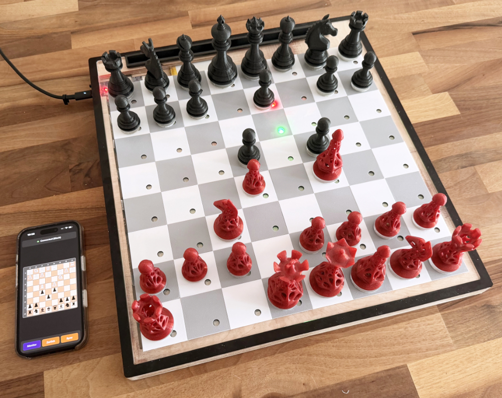

Maker Media GmbH

***

# Remote Chess

**Nicht immer kann man sich für eine Partie Schach am selben Tisch treffen. Am Bildschirm oder gegen den Computer zu spielen, ist aber nicht dasselbe. In diesem Projekt vernetzen sich deshalb zwei selbstgebaute Schachbretter über das Internet, die jeden Handgriff erfassen und beim Gegner anzeigen. So spielt man mit echten Figuren, und per Videocall sieht man sich trotzdem.**

Hier findet ihr den MicroPython-Code, die PWA sowie Platinenlayouts und CAD-Zeichnungen.

Der vollständige Artikel zum Projekt steht in der **[Make-Ausgabe x/yy ab Seite z](https://www.heise.de/select/make/xxx)**.
